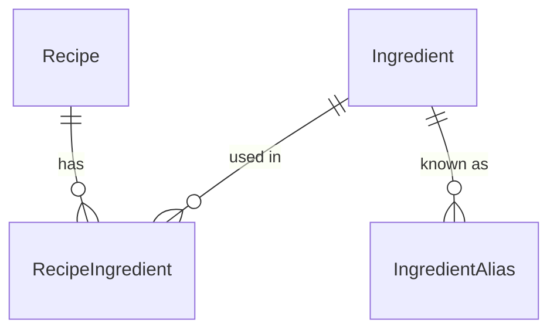

# 🎃 recipe-app — Self-Hosted Recipe & Shopping List

[](https://github.com/LittlePumpkin87/recipe-app/actions/workflows/ci.yml)


> **Self-hosted, ad-free web application for managing recipes, generating weekly
> suggestions and deriving a shopping list from them.**
>
> A private project for a single household to begin with: no multi-tenancy, no public
> sign-up. Opening it up as a multi-user application is the long-term plan and is already
> designed — see [Multi-user (V4)](docs/DECISIONS.md#multi-user-v4).
>
> It is also a learning project for backend development, which is why the V1 API exists
> **twice**: once in NestJS, once in ASP.NET Core, against the same PostgreSQL database and
> the same contract. CI runs both and compares their answers. Running the application
> needs only one of them; NestJS is the default.

## ✨ Why this exists

Four apps' worth of features, without the four apps:

- a recipe book and a weekly meal plan, like Chefkoch
- a shopping list built from that plan, like Bring!
- random suggestions for when nothing comes to mind, like HelloFresh — minus
  the subscription box
- calories and macros per serving, and what the planned week adds up to, like
  Lifesum — without logging every meal by hand

None of the four is new on its own. The point is that they stop being separate:
the plan is built from your own recipes, the shopping list is built from the
plan, and the nutrition figures come from the same recipes the plan is made of.
Because the plan already knows what is for dinner, the planned meals need no
logging. It is not a full food diary — a snack outside the plan is not counted —
but it answers the question most weeks actually pose.

Free, ad-free, no account required, running on hardware you own.

## 📊 Status

Under development. See [Roadmap](#roadmap) for what is and is not implemented.

## 🧱 Tech stack

| Layer          | Choice                                         |
| -------------- | ---------------------------------------------- |
| Backend        | NestJS, TypeScript                             |
| ORM            | Prisma                                         |
| Second backend | ASP.NET Core, C#, EF Core — same API, optional, [see decisions](docs/DECISIONS.md#second-backend-aspnet-core) |
| Database       | PostgreSQL 18                                  |
| Frontend       | Angular, standalone components                 |
| Runtime        | Docker Compose                                 |

## 📋 Requirements

- Node.js 24 (see `.nvmrc`)
- .NET SDK 10 (see `global.json`) — only for the second backend
- Docker with Compose v2
- Python 3 with a venv — only for the ingredient catalog tools, see
  [docs/TOOLS.md](docs/TOOLS.md)
- Optionally a PostgreSQL client (`postgresql-client`, DBeaver, pgAdmin) to
  connect to the database from the host

## 🚀 Getting started

```bash
# For Web connection
git clone https://github.com/LittlePumpkin87/recipe-app
# For SSH connection
git clone git@github.com:LittlePumpkin87/recipe-app.git

cd recipe-app

# 1. Create your environment file
cp .env.example .env

# 2. Generate a database password and put it into BOTH POSTGRES_PASSWORD
#    and the password part of DATABASE_URL in .env
openssl rand -hex 32

# 3. Start the database
npm run db:up

# 4. Install dependencies
npm install

# 5. Create the database tables
npm run db:migrate

# 6. Optional: fill the database with development data
npm run db:seed

# 7. Start the API in watch mode
npm run start:nest
```

The API listens on http://localhost:3000.

Step 5 is the one that is easy to miss: steps 1 to 4 leave you with a running
but completely empty database. See [Prisma and migrations](docs/DATABASE.md#prisma-and-migrations)
for what that command does and why Prisma runs from inside `apps/api` (the
`db:*` scripts change into it for you). All root scripts are listed in the
Scripts section below.

Verify that the database is up:

```bash
docker compose ps          # db should report "healthy"
```

### Running the .NET backend instead

The second backend serves the same endpoints from the same database. Only one of
them runs at a time. Steps 1 to 5 above still apply — the database and its tables
are shared, and Prisma owns the schema either way. Node.js is therefore needed
for the .NET backend too: Prisma applies the migrations, and the seed and the
ingredient catalog are loaded by TypeScript scripts. The .NET API itself runs
without it.

```bash
npm run start:dotnet
```

It listens on http://localhost:5000, so it does not collide with the NestJS API
on port 3000. `requests.http` sits in the repository root and is written for
httpYac (VS Code extension `anweber.vscode-httpyac`, npm package `httpyac`). It
takes `{{host}}` from `http-client.env.json`, which defines two environments,
`nest` and `dotnet`. In the editor you pick one with httpYac's environment
switch; on the command line:

```bash
npm run test:dotnet    # reseeds, then sends every request to port 5000
```

The script runs the seed first, because the requests expect the development
data and a second run would otherwise hit 409 on ingredients the first run
created.

The file deliberately has no `@host` line: a variable defined in the `.http`
file overrides the environment, and `--var` on the command line does not win
against it either when `--all` is used.

The port lives in `apps/api-dotnet/Properties/launchSettings.json`. That file is
read by `dotnet run` only — a container ignores it and takes `ASPNETCORE_URLS`
instead.

**Editor support.** The Microsoft C# extension is not available on Open VSX,
because its licence restricts it to official Visual Studio Code builds. VSCodium
users need an alternative; this project uses
[DotRush](https://open-vsx.org/extension/nromanov/dotrush) (`nromanov.dotrush`),
which brings its own Roslyn-based language server.

### A note on the password

`DATABASE_URL` is a URI, in which `:`, `@`, `/`, `?` and `#` carry structural
meaning. A password containing any of them breaks the connection string unless
it is percent-encoded — and then the same secret would have to be written in
two different spellings inside `.env`.

Generating the password with `openssl rand -hex 32` avoids this: hex output
contains only `0-9a-f`, so the identical literal can be used in both places.
Do not use `openssl rand -base64`, whose alphabet includes `+`, `/` and `=`.

## 📁 Repository layout

This is an npm workspaces monorepo. Application packages live under `apps/`.

```
.
├── apps/
│   ├── api/                # NestJS backend (workspace name: "api")
│   │   ├── prisma/         # schema, migrations, seed.ts, ingredient-catalog.json
│   │   └── src/
│   │       ├── common/             # helpers shared by seed and services
│   │       ├── generated/prisma/   # Prisma client — generated, never edited
│   │       ├── import/             # allrecipes adapter and import script
│   │       ├── prisma/             # PrismaService, global
│   │       ├── recipes/            # feature module
│   │       └── ingredients/        # feature module
│   └── api-dotnet/         # ASP.NET Core backend (project: RecipeApi)
│       ├── Controllers/    # attribute-routed controllers
│       ├── Services/       # business logic and the only place queries live
│       ├── Dtos/           # response records — one file per resource
│       ├── Data/           # RecipeDbContext — scaffolded, plus one partial
│       ├── Models/         # entity classes — scaffolded, plus the Unit and Language enums
│       ├── Exceptions/     # ConflictException and its handler (409)
│       ├── Utility/        # DATABASE_URL → Npgsql, name normalizing, decimal validation
│       └── Properties/     # launchSettings.json — local ports only
├── .github/workflows/      # ci.yml — builds and compares both backends
├── .config/                # dotnet-tools.json — pins dotnet-ef
├── docs/                   # every .md besides this README, see Documentation below
├── tools/                  # data preparation, catalog tools, CI compare script — see docs/TOOLS.md
├── data/                   # downloaded data sets — gitignored, never committed
├── requests.http           # example requests — tests either backend
├── http-client.env.json    # httpYac environments: nest (3000), dotnet (5000)
├── docker-compose.yml      # local infrastructure
├── global.json             # pins the .NET SDK version
├── .env                    # local secrets — never committed
└── .env.example            # template for .env
```

## ⚙️ Scripts

The root `package.json` holds short scripts for the commands used every day:

```bash
npm run db:up          # start the Postgres container
npm run db:down        # stop it, keep the data
npm run db:psql        # SQL shell inside the container
npm run db:backup      # pg_dump into backup.sql (gitignored)
npm run db:restore     # load backup.sql into an empty database
npm run db:generate    # prisma generate (the client is gitignored)
npm run db:migrate     # prisma migrate dev; add a name with: -- --name <name>
npm run db:deploy      # prisma migrate deploy
npm run db:seed        # wipe and rewrite the development data
npm run db:studio      # prisma studio
npm run db:read        # re-scaffold the EF Core models from the database
npm run start:nest     # NestJS in watch mode, port 3000
npm run start:dotnet   # ASP.NET Core, port 5000
npm run build          # build both backends (build:nest, build:dotnet)
npm run serve:nest     # run the NestJS build from dist/, no watch
npm run serve:dotnet   # run the .NET build without rebuilding
npm run test:nest      # seed, then send requests.http to NestJS
npm run test:dotnet    # seed, then send requests.http to ASP.NET Core
npm run compare        # both runs, then tools/compare-responses.ts
npm run import:allrecipes
```

`start:*` is for development, `serve:*` runs what `build` produced, as CI
does. There is deliberately no script for `docker compose down -v`, which
deletes the database volume.

`test:*` and `compare` run the seed, which empties all tables. Do not run them
against a database that holds the bulk import. `compare` needs both backends
running at the same time; see [docs/TOOLS.md](docs/TOOLS.md#compare-responsests).

Workspace scripts, code conventions, CI and validation are described in
[docs/BACKEND.md](docs/BACKEND.md).

## 🗄️ Data model

Four models and two enums (`Unit`, `Language`). The join table carries the amount, the unit and three
presentation fields in addition to the relation, which is why it is written out
explicitly rather than left to Prisma's implicit many-to-many.



| Model | Purpose |
|---|---|
| `Recipe` | Title, description, instructions, servings, `prepMinutes` and `totalMinutes`, `language` (default `DE`), optional import provenance. |
| `Ingredient` | Central ingredient list. One row per ingredient in every language, shared across recipes: `nameEn`, `nameEnPlural`, `nameDe`, `nameDePlural` for display (each nullable, at least one set), `nameNormalized` plus `language` as the row's unique key. |
| `IngredientAlias` | Every spelling of an ingredient, per language, normalized: (eier, DE) and (eggs, EN) both point at the row "egg". Unique on (`alias`, `language`). A recipe line is resolved through this table only. |
| `RecipeIngredient` | Join table between the two, carrying `amount`, `unit`, a per-line `note`, a `groupLabel` and the `position` within the recipe. |

Naming, migrations, the seed and working with the container:
[docs/DATABASE.md](docs/DATABASE.md).

## 🔌 API endpoints

V1 only. There is no login, and no endpoint is authenticated. Both backends serve
the same contract.

| Method | Path | Purpose |
|---|---|---|
| GET | `/recipes` | List, with optional `?search=` on the title |
| GET | `/recipes/:id` | Single recipe including its ingredients |
| POST | `/recipes` | Create, including the ingredient list |
| PATCH | `/recipes/:id` | Update; a present ingredient list replaces the old one |
| DELETE | `/recipes/:id` | Delete, `204` without a body |
| GET | `/ingredients` | Autocomplete, `?search=`, capped at 20 results |
| POST | `/ingredients` | Create an ingredient, 409 if the name exists |

How each endpoint works behind the table: [docs/API.md](docs/API.md).

## ⚡ Feature spotlight: one request, one transaction

`POST /recipes` takes a recipe and its whole ingredient list in one request.
Ingredients are named, not referenced by id: for each line the service
normalizes the name, looks it up as an alias in the recipe's language, and
either links the existing ingredient or creates a new one. Ingredients, recipe
and join rows are written in **one transaction**, so a failure halfway leaves
nothing behind — no new ingredient without its recipe. Both backends do the
same, against the same unique indexes. The full walkthrough is in
[docs/API.md](docs/API.md#post-recipes-one-request-one-transaction).

<a id="roadmap"></a>

## 🛠️ Roadmap

**V1** — recipe CRUD, central ingredient list without duplicates, search by
title, mobile friendly, WCAG AA.

**V2** — random weekly suggestions, meal plan, shopping list. Also where
validation in the .NET backend is revisited: V1 uses DataAnnotations, and
FluentValidation is the planned replacement once the rules grow. See
[Validation](docs/DECISIONS.md#validation).

**V3** — recipe import from URLs via schema.org metadata.

**V4** — multi-user operation. Designed, deliberately not built. See
[Multi-user (V4)](docs/DECISIONS.md#multi-user-v4).

**Later** — tags (vegetarian, quick, oven dish) and nutrition figures, both
usable as filters for the random suggestions. See [Nutrition](docs/DECISIONS.md#nutrition). A
photo per recipe, see [Recipe images](docs/DECISIONS.md#recipe-images).

**Build order within V1.** The API gets a second implementation before the
application gets a frontend: the NestJS API is finished first, then rebuilt in
ASP.NET Core, then the Angular frontend follows, and finally Docker Compose.
The CI pipeline that builds both backends and runs the same requests against
each already exists, see [CI](docs/BACKEND.md#ci).
See [Second backend: ASP.NET Core](docs/DECISIONS.md#second-backend-aspnet-core).

## 📄 License

Copyright (C) 2026 Little Pumpkin Design (Jennifer Roob)

Licensed under the GNU Affero General Public License v3.0 — see [LICENSE](LICENSE).

Section 13 of the AGPL requires that anyone interacting with the software over a
network be offered a link to its source. There is no user interface yet; the
link will be part of the frontend from the moment one exists.

---

## 📖 Documentation

| File | Contents |
|---|---|
| [docs/BACKEND.md](docs/BACKEND.md) | NestJS workspace and code conventions, CI, DTOs, mappers and validation |
| [docs/DATABASE.md](docs/DATABASE.md) | Naming convention, Prisma and migrations, seeding, Prisma Studio, the database container, timestamps, pitfalls, backups |
| [docs/API.md](docs/API.md) | How the endpoints work: the two searches, `POST`, `PATCH` and `DELETE /recipes`, duplicate handling |
| [docs/IMPORT.md](docs/IMPORT.md) | Bulk import of the allrecipes data: steps, counters, how a line is read, what gets skipped |
| [docs/DECISIONS.md](docs/DECISIONS.md) | Every design decision, including the alternatives that were rejected and why — data model, the second backend, nutrition, images, multi-user, and the accepted audit findings |
| [docs/TOOLS.md](docs/TOOLS.md) | Where imported recipe data comes from, its licence, how to reproduce the converted file, the ingredient catalog tools and the CI compare script |
| [requests.http](requests.http) | Example requests, runnable against either backend |
| [http-client.env.json](http-client.env.json) | The two httpYac environments `requests.http` runs in |
